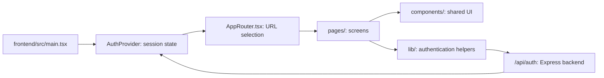

# Talk frontend architecture

The frontend is the website people see and use. It lives in `frontend/`, uses React and TypeScript, and is built by Vite. Its workspace is `@talk/frontend`, with dependencies declared in `frontend/package.json`. Paths in this guide are relative to the repository root.

For authentication APIs, storage and email delivery, see [BACKEND.md](BACKEND.md).

The sign-in page's **Forgot password?** link opens `pages/ForgotPassword.tsx` at `/forgot-password`. It reuses `AuthLayout`, `OtpCodeInput` and the existing authentication request helper for email code verification and choosing a new password. See [Password recovery](deployment/PASSWORD_RESET.md).

The existing whiteboard lazily opens a canvas-assistant panel for native proposals and source-based analysis. Smart Drawing adds local, confirmed geometry conversion without replacing the canvas or meeting. See [Phase 10H](deployment/PHASE10H_INTELLIGENT_WHITEBOARD.md) for capability/provider boundaries and tests.

## How the parts connect



The browser requests the current session from the backend. React holds the returned display profile and session status; the browser manages the HttpOnly session cookie. The backend decides whether a session is valid.

## Folder map

```text
frontend/
  src/
    main.tsx              React entry; mounts AuthProvider and AppRouter
    AppRouter.tsx         Routes, navigation events and page titles
    pages/                Landing, meeting, account and dashboard screens
    components/           Shared layouts, OTP boxes and feature sections
    lib/                  API clients, authentication state and SDK helpers
    hooks/                Media preview and embedded participant hooks
    index.css             Tailwind entry, CSS imports and base styles
    styles/               Site, dashboard, account and responsive styles
    design/               Shared design tokens and imported HTML markup
  public/                 Locally served images, fonts and videos
  index.html              HTML document containing the React root
  vite.config.ts          Build configuration and local API integration
  tsconfig.json           Frontend TypeScript scope, extending the root config
  package.json            Frontend workspace dependencies and commands
```

The active entry is `main.tsx` importing `AppRouter.tsx`. Routing uses browser History API events and a route switch, rather than React Router. Phone authentication pages are loaded lazily.

## Main screens

| URL | Screen file | Purpose |
| --- | --- | --- |
| `/` | [Landing.tsx](frontend/src/pages/Landing.tsx) | Landing page; combines imported HTML with React feature sections |
| `/webinars` | [Webinar.tsx](frontend/src/pages/Webinar.tsx) | Webinar information and registration preview |
| `/device-test`, `/test` | [DeviceTest.tsx](frontend/src/pages/DeviceTest.tsx) | Camera, microphone and speaker checks |
| `/meeting` | [MeetingRoom.tsx](frontend/src/pages/MeetingRoom.tsx) | Meeting preview, controls and whiteboard |
| `/bookings` | [Booking.tsx](frontend/src/pages/Booking.tsx) | Booking preview |
| `/sign-in`, `/sign-up` | [SignIn.tsx](frontend/src/pages/SignIn.tsx), [SignUp.tsx](frontend/src/pages/SignUp.tsx) | Email, Google and phone sign-in entry points |
| `/verify-email` | [VerifyEmail.tsx](frontend/src/pages/VerifyEmail.tsx) | Email OTP entry, resend and recovery |
| `/phone-sign-in`, `/verify-phone` | [PhoneSignIn.tsx](frontend/src/pages/PhoneSignIn.tsx), [VerifyPhone.tsx](frontend/src/pages/VerifyPhone.tsx) | Phone number, reCAPTCHA and SMS code entry |
| `/choose-account`, `/confirm-sign-in` | [ChooseAccount.tsx](frontend/src/pages/ChooseAccount.tsx), [ConfirmSignIn.tsx](frontend/src/pages/ConfirmSignIn.tsx) | Talk account selection and Google profile confirmation |
| `/dashboard` | [Dashboard.tsx](frontend/src/pages/Dashboard.tsx) | Authenticated overview, wrapped by `DashboardAccess` |

## Where to make changes

| Change | Start here |
| --- | --- |
| Add a page or URL | `frontend/src/pages/` and `frontend/src/AppRouter.tsx` |
| Change navigation or footer | `frontend/src/components/Navbar.tsx`, `Footer.tsx` and `Shell.tsx` |
| Show or hide workspace sidebar items | `frontend/src/lib/workspaceNavigation.ts` (`visibleInSidebar` for each item) |
| Change the hero/globe | `frontend/src/components/HeroGlobe.tsx`, `frontend/src/pages/Landing.tsx` and `frontend/src/styles/talk.css` |
| Change shared colors | `frontend/src/design/tokens.css`; check related rules in `frontend/src/styles/` |
| Change email OTP UI | `frontend/src/pages/VerifyEmail.tsx` and `frontend/src/components/OtpCodeInput.tsx` |
| Change session UI or redirects | `frontend/src/lib/auth.tsx` and `frontend/src/components/DashboardAccess.tsx` |
| Change email API requests | `frontend/src/lib/emailAuth.ts` |
| Change Google button/SDK integration | `frontend/src/components/GoogleSignIn.tsx` and `frontend/src/lib/googleIdentity.ts` |
| Change phone/reCAPTCHA integration | `frontend/src/lib/firebase.ts` and `frontend/src/lib/phoneAuth.ts` |
| Change media preview or whiteboard | `frontend/src/hooks/`, `frontend/src/components/CameraPreview.tsx` and `MeetingWhiteboard.tsx` |
| Change real meeting join/media controls | `frontend/src/lib/meetingSession.ts`, `frontend/src/components/LiveMeeting.tsx` and `frontend/src/pages/DeviceTest.tsx` |

`Landing.tsx` imports `frontend/src/design/landing.html` and mounts React sections into it. Some landing content therefore lives in that HTML file rather than in a standalone React component. Local asset URLs such as `/reference/...` map to files under `frontend/public/reference/`.

The workspace sidebar currently shows Overview and Meetings. Webinars, Bookings, Agendas, Transcripts and Cloud storage remain in `workspaceNavigation.ts` with `visibleInSidebar: false`; set an individual entry to `true` when ready. This setting only controls the sidebar menu. Existing routes, dashboard cards, previews and data remain available; it does not control access or authentication.

The existing pre-join screen now connects authenticated users to LiveKit through `/meeting?live=1&room=talk-workshop`. Its preview tracks and selected devices are handed to the live room; API tokens stay in memory. The original `/meeting` sample/recording preview remains available. See [deployment/MEETINGS.md](deployment/MEETINGS.md) for local setup, access policy and real transport testing.

Phase 2 extends only the live meeting: `MeetingCanvas.tsx` manages adaptive grids, pinned/focused participants and screen presentations; `MeetingPanels.tsx` contains participants, session-only chat, meeting information and device settings. `useMeetingChat.ts` sends validated text through real LiveKit data channels. `LiveMeeting.tsx` retains connection, media-toggle and cleanup ownership. These additions do not replace the pre-join screen or its tests.

Phase 3 adds `useMeetingManagement.ts` and `MeetingModeration.tsx` for backend-authorized roles, waiting requests, participant actions, hand order, reactions and More options. Host badges now use persisted creator roles instead of join order. The existing dashboard Start a session action creates an owned meeting, then opens the same pre-join page. Waiting joins render inside the existing live route without a LiveKit connection. See [deployment/PHASE3_MEETINGS.md](deployment/PHASE3_MEETINGS.md) for policy, gateway routing and tests.

## Authentication from the browser

- **Email:** signup submits to the backend, then opens `/verify-email`. Successful code verification creates a Talk session and opens `/dashboard`.
- **Google:** the official Google Identity Services popup returns a credential to Talk. The backend verifies it, then the user reviews `/confirm-sign-in` before entering the dashboard.
- **Phone:** the Firebase browser SDK handles reCAPTCHA and the SMS code. Talk sends the resulting Firebase ID token to its backend for verification and exchanges it for a Talk session.

`DashboardAccess` waits for a session check, sends guests to sign-in and sends pending Google sessions to confirmation. It controls screen access; backend handlers enforce API authorization independently.

Authentication requests use same-origin `/api/auth/...` URLs and cookies. Firebase phone credentials stay in memory and are cleared after the backend exchange or when leaving the flow. Browser password-saving support is in `frontend/src/lib/browserPasswords.ts`.

## Run and build

From the repository root (install both workspaces with one command):

```powershell
npm ci
npm run dev
```

Open **http://localhost:3001**. The Vite plugin also mounts the Express authentication API, so development does not require a second backend command or API port.

The root `dev` and `build` scripts delegate to `@talk/frontend`. Vite's root is `frontend/`, while `envDir` points at the repository root to preserve the existing private `.env.local` configuration. Browser URLs remain `/src/...`, `/reference/...` and `/api/...`; physical workspace paths are not added to website URLs.

The development file server allows frontend sources and installed dependencies, keeping backend source and root account data outside its browser file boundary.

```powershell
npm run lint
npm run build
```

The build writes the frontend to `frontend/dist/`. `npm run preview` serves static files only. For local authentication with the built app, stop the development server, then run `npm start` with the existing local configuration.

Browser regressions are under `tests/`, including `email-auth-browser.mjs`, `google-confirmation-browser.mjs`, `firebase-phone-browser.mjs` and `hosting-auth-browser.mjs`. See [README.md](README.md#verify) for prerequisites and commands. Fixture tests do not send real email or SMS.

## Configuration and production boundary

Video backgrounds extend the existing pre-join camera preview and meeting Settings. `useBackgroundPreview` processes a capture clone, `useMeetingBackground` manages the published camera, and `TalkCameraProcessor` wraps the pinned LiveKit processor. The `BackgroundSettings` picker is shared between screens. Preferences are per-account browser data; custom uploads use existing authenticated backend APIs. Model/runtime assets are self-hosted under `public/vendor/backgrounds/`. See [video background architecture and tests](deployment/VIDEO_BACKGROUNDS.md).

Appearance, filters and studio lighting share that same camera processor and picker; see [video effects controls, processing and tests](deployment/VIDEO_EFFECTS.md).

`Avatar.tsx` is the static avatar rendering boundary; `AvatarPicker.tsx` is reused by dashboard Profile settings and in-meeting Settings. `ReactionPicker.tsx` adds categories/search/recents to the existing meeting panels. The public `avatarCatalog.js` and `reactionCatalog.js` modules are also backend allowlists. Profile saves update the existing AuthProvider without changing session state, so media connections remain active. Camera-off tiles obtain authenticated profile descriptors from meeting state, not untrusted LiveKit metadata. Original presets and future-renderer boundaries are documented in [deployment/REACTIONS_AVATARS.md](deployment/REACTIONS_AVATARS.md).

`VITE_FIREBASE_*` values are public browser configuration. Anything prefixed `VITE_` can appear in the frontend build. SMTP passwords, database credentials, cookie keys and private test codes belong exclusively in backend/private configuration.

The prepared production architecture serves `frontend/dist/` from Firebase Hosting and rewrites `/api/...` requests to Cloud Run. The frontend keeps using same-origin API URLs. See [the deployment guide](deployment/FIREBASE_HOSTING.md) for configuration, readiness checks and required approvals.

The dashboard library, booking, chat and Q&A include sample/local preview behavior. Camera and microphone features use browser media APIs; these screens are not a deployed multi-user conferencing backend.

## Recording and transcripts

`MeetingRecording.tsx` and `useMeetingRecording.ts` extend existing pre-join/meeting controls with server-authoritative consent and recording status. `MeetingHistory.tsx` implements protected `/meeting-history` and `/meeting-history/:meetingId` for private playback, search and exports. See [recording setup](deployment/RECORDING_TRANSCRIPTION.md).

Phase 10 adds a lazy in-meeting `Whiteboard` / `WhiteboardCanvas` editor and a saved Whiteboard tab in Meeting Details. See [whiteboard architecture and local testing](deployment/PHASE10_WHITEBOARD.md).
