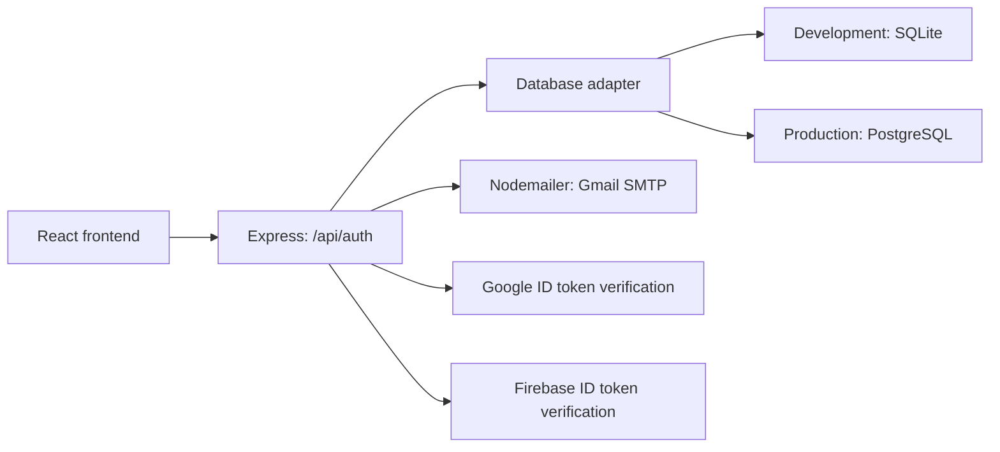

# Talk backend architecture

The backend verifies identities, sends email verification codes and manages Talk accounts and sessions. It lives in `server/` and uses Node.js and Express. All paths in this guide are relative to this folder, which contains `package.json`.

For pages, components and browser authentication helpers, see [FRONTEND.md](FRONTEND.md).

## How the parts connect



Google and Firebase prove identity. Talk's database and opaque session cookies remain the application's session authority for all three sign-in methods.

## Folder and file map

| File or folder | Responsibility |
| --- | --- |
| [server/index.mjs](server/index.mjs) | Standalone server, environment loading, health check, static frontend serving and shutdown |
| [server/runtime-auth.mjs](server/runtime-auth.mjs) | Wires configuration, database and authentication providers for development or production |
| [server/auth.mjs](server/auth.mjs) | Authentication endpoints, validation, hashing, verification challenges, sessions, CSRF, account linking and limits |
| [server/database.mjs](server/database.mjs) | Local SQLite connection and versioned migrations |
| [server/async-database.mjs](server/async-database.mjs) | Awaitable database interface, transaction contexts and concurrency locks |
| [server/postgres-database.mjs](server/postgres-database.mjs) | Production PostgreSQL pool, connection policy, SQL parameters and migration support |
| [server/migrations/](server/migrations/) | SQLite schema migrations |
| [server/postgres-migrations/](server/postgres-migrations/) | PostgreSQL schema migrations |
| [server/mailer.mjs](server/mailer.mjs) | Talk verification email and STARTTLS SMTP transport |
| [server/firebase-auth.mjs](server/firebase-auth.mjs) | Firebase Admin ID-token signature verification for phone authentication |
| [server/hosting-cookies.mjs](server/hosting-cookies.mjs) | Encrypts the existing cookie values into Firebase Hosting's `__session` cookie |
| [server/client-ip.mjs](server/client-ip.mjs) | Resolves client IPs using explicitly trusted proxies for rate limiting |
| [server/production-config.mjs](server/production-config.mjs) | Validates required production settings and HTTPS policy |
| [server/migrate-production.mjs](server/migrate-production.mjs) | Explicit production schema migration entry point |
| [server/import-sqlite.mjs](server/import-sqlite.mjs) | Transactional import into an empty, migrated PostgreSQL database |
| [deployment/](deployment/) | Production templates, grants, environment example and deployment instructions |

## Development versus production

| Concern | Local development | Prepared production architecture |
| --- | --- | --- |
| Frontend | Vite at `http://localhost:3001` | Firebase Hosting serves `dist/` |
| API entry | `vite.config.ts` mounts `createRuntimeAuth()` | Cloud Run starts `server/index.mjs` and `createProductionAuth()` |
| API URL in browser | Same-origin `/api/auth/...` | Same-origin `/api/auth/...`, forwarded by Hosting |
| Storage | SQLite, default `data/talk.sqlite` | Durable PostgreSQL; Cloud SQL template provided |
| Schema changes | SQLite migrations run at startup | Separate, explicit migration job before app startup |
| Cookies | Separate native HttpOnly cookies; Secure on HTTPS | One encrypted, Secure, HttpOnly, SameSite=Lax `__session` cookie |
| Configuration | `.env.local`, then `.env`; existing process settings take precedence | Injected environment/Secret Manager; local env files are not loaded |

For a local built-app check, `npm run build` followed by `npm start` serves both `dist/` and the API from Express. Stop Vite first to free port 3001. `NODE_ENV=production` selects the strict PostgreSQL/HTTPS production configuration, not the local SQLite path.

## API map

All authentication paths below start with `/api/auth`. Read the handlers in `server/auth.mjs` for request bodies and the required CSRF/challenge context.

| Method | Path | Purpose |
| --- | --- | --- |
| GET | `/config` | Public authentication challenge, Google client ID and CSRF context |
| GET | `/session` | Current Talk profile, session CSRF context and Google confirmation status |
| POST | `/google`, `/google/confirm` | Verify a Google credential, then confirm the pending Talk session |
| GET | `/email/config`, `/email/verification` | Email availability and the current browser-bound verification state |
| POST | `/email/signup` | Validate signup, stage password hash and send a verification email |
| POST | `/email/login`, `/email/resume` | Password login or resume verification for an unverified account |
| POST | `/email/verify` | Consume a valid code and issue a Talk session |
| POST | `/email/resend`, `/email/change` | Rotate the email code or cancel the current verification flow |
| POST | `/email/link/start` | Begin verified password linking for an existing signed-in account |
| GET | `/phone/config`, `/phone/challenge` | Phone availability, CSRF context and pending phone challenge |
| POST | `/phone/start` | Create a rate-limited Talk challenge before the browser requests an SMS |
| POST | `/phone/verify`, `/phone/cancel` | Exchange the Firebase ID token for a session, or cancel the flow |
| POST | `/logout` | Revoke the Talk session and clear its cookie |

The standalone server also exposes `GET /healthz` for readiness. Production checks the database before returning success. Vite development mounts the authentication API directly and does not use that standalone health endpoint.

## Authentication flows

### Email and password

1. Signup sends name, email and password to Talk's backend.
2. The backend validates the input, hashes the password and verification code with salted scrypt, and persists a browser-bound challenge.
3. Nodemailer sends the six-digit code through Gmail SMTP using STARTTLS on port 587.
4. `/verify-email` submits the code to the backend. Only successful verification marks the email verified and creates the session.
5. The frontend opens `/dashboard`. Later password login uses the same session system; unverified users resume verification.

Codes expire after **five minutes**, allow **five incorrect attempts**, and are single-use. Resends have a **60-second cooldown** and invalidate the previous code. Persistent per-email/IP limits provide additional controls. See [README.md](README.md#email-verification-and-local-testing) for the complete limits and recovery behavior.

### Google

The official Google popup returns an ID token. The backend verifies the credential and challenge, creates a pending Talk session, and requires `/confirm-sign-in` before dashboard access. A matching email address does not automatically merge a Google identity with a password account.

### Phone

The browser obtains a Talk challenge, completes Firebase reCAPTCHA and verifies the SMS code with Firebase. It sends the resulting ID token to `/phone/verify`. The backend validates the signed token, project, phone identity and recent proof against the pending challenge before issuing a Talk session. The backend does not generate or send Firebase SMS codes.

`server/firebase-auth.mjs` verifies signatures using public certificates without an Admin private key. Revoked/disabled Firebase-user lookups are not enabled; Talk session expiry and logout remain authoritative. Explicit phone linking requires the same recently authenticated Talk session and never silently merges existing accounts.

## Data and session ownership

| Tables | Stored purpose |
| --- | --- |
| `accounts` | Talk account ID and display profile |
| `identities`, `phone_profiles` | Provider-to-account mapping, password hashes and verified phone details |
| `sessions` | Hashed opaque session identifiers, expiry, authentication method, CSRF and confirmation status |
| `google_challenges`, `email_challenges`, `phone_challenges` | Pending browser-bound verification state and expiry; email codes are hashed |
| `phone_token_uses` | Hashed consumed Firebase proofs for replay protection |
| `rate_limits` | Persistent request counters and reset times |
| `schema_migrations` | Applied schema versions |

Sessions expire after **eight hours**. PostgreSQL transactions and locks protect concurrent verification and linking. Production cookies are encrypted envelopes containing the existing opaque cookie values; database session hashes still determine validity and logout. Persist the encryption key across instances and restarts.

Passwords, plaintext OTPs and provider ID tokens must not be logged or committed. See [deployment/backend.env.example](deployment/backend.env.example) for backend variable names, and [.env.example](.env.example) for local/public configuration placeholders. Keep actual SMTP, database and cookie credentials private; never prefix them `VITE_`.

## Commands and verification

Run commands from the directory containing this guide, using Node 22.17 or newer:

```powershell
npm install
npm run dev                      # Frontend and local authentication API together
npm run test:auth                # Isolated SQLite/API/mailer tests
npm run test:auth:production-unit # Production security unit checks; real PG flow skips
npm run test:auth:production     # Disposable local PostgreSQL integration tests; Docker required
npm run lint
npm run build
```

When Docker Desktop port forwarding is unavailable, the same PostgreSQL tests can run entirely inside the backend image:

```powershell
docker build -t talk-auth:local-check .
node scripts/test-backend-image.mjs --auth-tests
```

These checks use simulated provider proofs and captured email delivery. They do not prove real inbox or SMS delivery. Real-Firebase fictional-number tests are separate from real SMS tests; follow the workflows in [README.md](README.md#safe-local-test-numbers).

For cloud infrastructure, backups, account-data import, Google HTTPS origins, secret handling and deployment approvals, follow [deployment/FIREBASE_HOSTING.md](deployment/FIREBASE_HOSTING.md). Preparation/test commands do not deploy the application. The current backend implements authentication; meeting participants, bookings, chat and Q&A are local/sample previews rather than a conferencing service.
