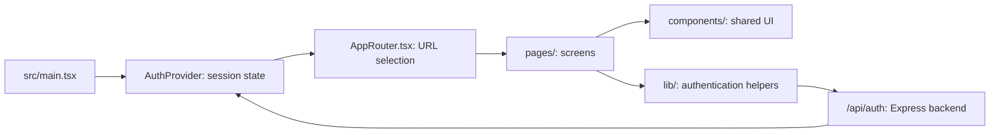

# Talk frontend architecture

The frontend is the website people see and use. It lives in `src/`, uses React and TypeScript, and is built by Vite. All paths in this guide are relative to this folder, which contains `package.json`.

For authentication APIs, storage and email delivery, see [BACKEND.md](BACKEND.md).

## How the parts connect



The browser requests the current session from the backend. React holds the returned display profile and session status; the browser manages the HttpOnly session cookie. The backend decides whether a session is valid.

## Folder map

```text
src/
  main.tsx                React entry point; mounts AuthProvider and AppRouter
  AppRouter.tsx           Routes, navigation events and page titles
  pages/                  Landing, meeting, account and dashboard screens
  components/             Shared layouts, buttons, OTP boxes and feature sections
  lib/                    API clients, authentication state and SDK helpers
  hooks/                  Camera/microphone preview and embedded participant hooks
  index.css               Tailwind entry, shared CSS imports and base styles
  styles/                 Site, dashboard, account and responsive styles
  design/                 Shared design tokens and imported HTML markup
public/                   Locally served images, fonts, videos and other assets
index.html                HTML document containing the React root
vite.config.ts            Build configuration and development API integration
```

The active entry is `main.tsx` importing `AppRouter.tsx`. Routing uses browser History API events and a route switch, rather than React Router. Phone authentication pages are loaded lazily.

## Main screens

| URL | Screen file | Purpose |
| --- | --- | --- |
| `/` | [Landing.tsx](src/pages/Landing.tsx) | Landing page; combines imported HTML with React feature sections |
| `/webinars` | [Webinar.tsx](src/pages/Webinar.tsx) | Webinar information and registration preview |
| `/device-test`, `/test` | [DeviceTest.tsx](src/pages/DeviceTest.tsx) | Camera, microphone and speaker checks |
| `/meeting` | [MeetingRoom.tsx](src/pages/MeetingRoom.tsx) | Meeting preview, controls and whiteboard |
| `/bookings` | [Booking.tsx](src/pages/Booking.tsx) | Booking preview |
| `/sign-in`, `/sign-up` | [SignIn.tsx](src/pages/SignIn.tsx), [SignUp.tsx](src/pages/SignUp.tsx) | Email, Google and phone sign-in entry points |
| `/verify-email` | [VerifyEmail.tsx](src/pages/VerifyEmail.tsx) | Email OTP entry, resend and recovery |
| `/phone-sign-in`, `/verify-phone` | [PhoneSignIn.tsx](src/pages/PhoneSignIn.tsx), [VerifyPhone.tsx](src/pages/VerifyPhone.tsx) | Phone number, reCAPTCHA and SMS code entry |
| `/choose-account`, `/confirm-sign-in` | [ChooseAccount.tsx](src/pages/ChooseAccount.tsx), [ConfirmSignIn.tsx](src/pages/ConfirmSignIn.tsx) | Talk account selection and Google profile confirmation |
| `/dashboard` | [Dashboard.tsx](src/pages/Dashboard.tsx) | Authenticated overview, wrapped by `DashboardAccess` |

## Where to make changes

| Change | Start here |
| --- | --- |
| Add a page or URL | `src/pages/` and `src/AppRouter.tsx` |
| Change navigation or footer | `src/components/Navbar.tsx`, `Footer.tsx` and `Shell.tsx` |
| Change the hero/globe | `src/components/HeroGlobe.tsx`, `src/pages/Landing.tsx` and `src/styles/talk.css` |
| Change shared colors | `src/design/tokens.css`; check related rules in `src/styles/` |
| Change email OTP UI | `src/pages/VerifyEmail.tsx` and `src/components/OtpCodeInput.tsx` |
| Change session UI or redirects | `src/lib/auth.tsx` and `src/components/DashboardAccess.tsx` |
| Change email API requests | `src/lib/emailAuth.ts` |
| Change Google button/SDK integration | `src/components/GoogleSignIn.tsx` and `src/lib/googleIdentity.ts` |
| Change phone/reCAPTCHA integration | `src/lib/firebase.ts` and `src/lib/phoneAuth.ts` |
| Change media preview or whiteboard | `src/hooks/`, `src/components/CameraPreview.tsx` and `MeetingWhiteboard.tsx` |

`Landing.tsx` imports `src/design/landing.html` and mounts React sections into it. Some landing content therefore lives in that HTML file rather than in a standalone React component. Local asset URLs such as `/reference/...` map to files under `public/reference/`.

## Authentication from the browser

- **Email:** signup submits to the backend, then opens `/verify-email`. Successful code verification creates a Talk session and opens `/dashboard`.
- **Google:** the official Google Identity Services popup returns a credential to Talk. The backend verifies it, then the user reviews `/confirm-sign-in` before entering the dashboard.
- **Phone:** the Firebase browser SDK handles reCAPTCHA and the SMS code. Talk sends the resulting Firebase ID token to its backend for verification and exchanges it for a Talk session.

`DashboardAccess` waits for a session check, sends guests to sign-in and sends pending Google sessions to confirmation. It controls screen access; backend handlers enforce API authorization independently.

Authentication requests use same-origin `/api/auth/...` URLs and cookies. Firebase phone credentials stay in memory and are cleared after the backend exchange or when leaving the flow. Browser password-saving support is in `src/lib/browserPasswords.ts`.

## Run and build

From the directory containing this guide:

```powershell
npm install
npm run dev
```

Open **http://localhost:3001**. The Vite plugin also mounts the Express authentication API, so development does not require a second backend command or API port.

```powershell
npm run lint
npm run build
```

The build writes the frontend to `dist/`. `npm run preview` serves static files only. For local authentication with the built app, stop the development server, then run `npm start` with the existing local configuration.

Browser regressions are under `tests/`, including `email-auth-browser.mjs`, `google-confirmation-browser.mjs`, `firebase-phone-browser.mjs` and `hosting-auth-browser.mjs`. See [README.md](README.md#verify) for prerequisites and commands. Fixture tests do not send real email or SMS.

## Configuration and production boundary

`VITE_FIREBASE_*` values are public browser configuration. Anything prefixed `VITE_` can appear in the frontend build. SMTP passwords, database credentials, cookie keys and private test codes belong exclusively in backend/private configuration.

The prepared production architecture serves `dist/` from Firebase Hosting and rewrites `/api/...` requests to Cloud Run. The frontend keeps using same-origin API URLs. See [the deployment guide](deployment/FIREBASE_HOSTING.md) for configuration, readiness checks and required approvals.

The dashboard library, booking, chat and Q&A include sample/local preview behavior. Camera and microphone features use browser media APIs; these screens are not a deployed multi-user conferencing backend.
